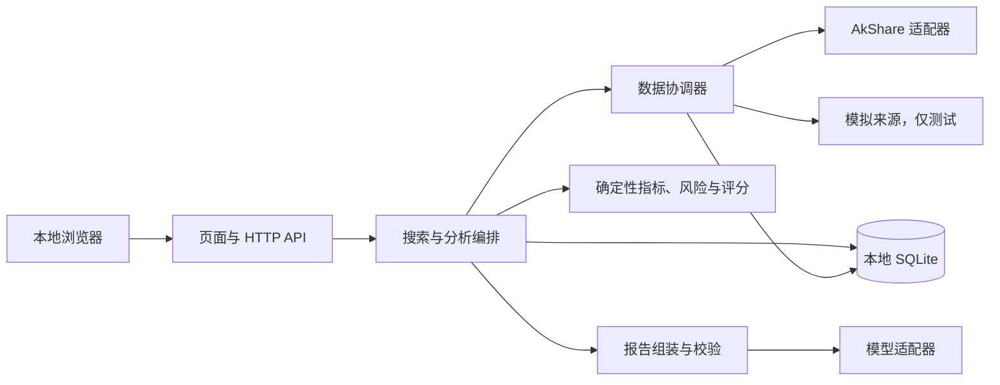

# TradingAgent MVP 架构设计

Phase 2 已通过评审 · 2026-11-10  
上游基线为 [TradingAgent MVP 需求规格](requirements.md)。第 10 节记录 Q-01 至 Q-07 的最终评审决策，并分别列明开发前必须确认的业务规则和开发阶段验证事项。需求文档第 11 节的原始问题与建议通过这些决策记录追踪。

## 1. 总体架构与选型

采用本地模块化单体。浏览器通过同源页面和 HTTP API 搜索与选股，单个 Python 服务负责编排、分析及呈现。SQLite 保存可复核的分析快照、报告和缓存。AkShare 和模型服务均通过服务端适配器访问。

| 决策 | 设计与理由 |
| --- | --- |
| AD-01 Web 与运行时 | 确认采用本地浏览器 Web UI 和 Python + FastAPI 单体。实现基线为 Python 3.12、Pydantic、Uvicorn，使用服务端模板和少量原生 JavaScript 展示搜索、走势、任务进度、报告和证据。验证请求、响应与模型输出使用显式 schema。浏览器与服务使用同一个端口，只有一套 Python 安装与启动流程。Python 小版本和依赖锁定须通过 AkShare 兼容性验证。 [FastAPI 模板](https://fastapi.tiangolo.com/advanced/templates/) · [响应模型](https://fastapi.tiangolo.com/tutorial/response-model/) |
| AD-02 数据与存储 | AkShare 和其表格数据依赖限制在适配层。领域模块用类型化记录和纯函数处理。SQLite 用标准库接口和版本化 SQL，满足单用户本地运行、短事务写入与快照追溯。 [Python sqlite3](https://docs.python.org/3.12/library/sqlite3.html) |
| AD-03 编排与模型 | 用固定步骤的 Python 工作流。股票工具由程序根据证券和数据类型调用。模型接收完成计算的证据包并解释风险、生成研究叙述。统一的 `LLMClient` 负责结构化生成，按配置指定 Provider 和模型名称。报告由用户主动触发，使用固定工作流和一次有界的叙述生成阶段。 |
| AD-04 作业执行 | Web 与分析作业共用一个服务。首版只允许一个活动分析，采用SQLite 持久化任务状态和进程内执行器，避免分析等待占用 HTTP 请求。数据访问按来源及全局限制并发。AkShare 的同步调用在可超时回收的本地子进程中执行，避免调用卡住后持续占用执行槽。 [Python 并发执行](https://docs.python.org/3/library/concurrent.futures.html) · [Python 子进程](https://docs.python.org/3/library/subprocess.html) |
| AD-05 测试 | pytest 覆盖确定性计算、数据接口契约与 HTTP 集成。离线固定样本与联网 AkShare 验收分开运行。浏览器主流程至少做一次端到端验证。 |

## 2. 模块职责与依赖

| 模块 | 职责与边界 |
| --- | --- |
| `web` | 路由、表单、API 校验、错误映射和报告呈现。仅依赖应用用例和返回契约。 |
| `application` | 搜索、选股、创建分析、推进作业状态，调用数据、领域规则、报告与存储接口。持有每次分析的基准时点、配置和截止时间。 |
| `market_data` | 定义统一请求与返回契约、来源注册、并行与选择、缓存读写及字段标准化。AkShare 的接口字段、DataFrame 与外部异常仅出现在适配器内。 |
| `analysis` | 纯函数计算财务、估值、技术、风险与评分。接受不可变的标准化快照和策略参数，输出结果及计算记录。无网络、数据库或模型依赖。 |
| `reporting` | 组装只读数据区和叙述区，调用模型适配器并校验叙述，处理部分报告与模型降级。 |
| `storage` | SQLite 事务、版本迁移、缓存、分析快照和报告。调用外部服务时不持有写事务。 |
| `bootstrap` | 读取配置，验证依赖和策略，装配服务、供应商、模型及持久化实现。生产注册表只启用 AkShare。 |

## 3. 核心模型与本地持久化

| 模型 | 核心字段与不变量 |
| --- | --- |
| `SecurityId / Security` | 交易所枚举与六位字符串代码构成标识，另有名称、板块、证券类型、行业分类及证据。行业未知显式标注。 |
| `DatasetRequest` | 数据类型、证券或市场范围、基准时点、窗口及所需口径。口径含周期、复权、币种、期间类型或合并范围等。 |
| `DatasetResult / SourceAttempt` | 数据行、来源及接口、版本、原字段及转换、尝试状态、耗时、原始获取时间、覆盖区间、质量、错误码。使用 `source_ref` 连接到行或字段。冲突记录包含候选来源、字段、数值、单位、时间、口径、裁决状态及选择依据。 |
| `Observation` | 数值或空、单位、标的、交易日期或财报期、可验证披露日、获取时间、适用性和质量状态。价格复权与会计口径随观测值保存。零值与空值分开。 |
| `AnalysisSnapshot` | 选中的证据记录、冲突和未选用摘要、有效输入、缺口、基准时点、取数参数、转换版本、计算及评分规则版本与完整生效配置。每份报告关联一份冻结快照。 |
| `MetricResult / RiskAssessment` | 类型区分来源值与确定性计算，保存可用性、数值或风险级别、规则及参数、输入引用和触发条件。风险记录包含类型、等级、触发指标、规则和依据。仅在符合聚合条件时输出综合风险等级，否则说明原因。 |
| `ScoreCard` | 适用策略、是否经过验证、维度状态、核心指标通过数与总数、缺失及质量问题、贡献、配置及生效权重、综合分或未生成原因。 |
| `AnalysisRun / ResearchReport` | 作业 ID、状态、阶段、基准时点、快照 ID、错误摘要及时间戳。报告包含 RP-01 至 RP-06 的结构化内容，叙述另记生成状态和所用模型与模板版本。 |

SQLite 中使用 `runs`、`snapshots`、`reports`、`dataset_cache`。运行状态和索引字段使用列，快照与报告以带 schema 版本的结构化 JSON 保存。快照保留实际参与计算的记录、证据原值和转换信息。缓存更新或淘汰与报告快照独立。保存快照及确定性报告时，在同一短事务中更新作业进度。最终叙述写入与终态变更也同一事务提交。使用约束防止重复作业记录，状态更新检查原状态。连接由各执行上下文独立管理，设置短的锁等待。数据库放本地磁盘，启用 WAL 后仍只有一个并发写入者。 [SQLite WAL](https://sqlite.org/wal.html)

缓存键包含来源及接口映射版本、证券或市场、数据类型、日期窗口、复权及相关口径。缓存有效期控制何时重新获取，业务时效按数据类型分别判断是否能参与评分。财务数据结合正式披露时间和报告期，日线结合交易日历和最近有效交易日，保留停牌与未知状态。缓存命中保留获取和观测时间。报告快照保存已接受的输入版本以支持离线复算，外部数据后续修订不会改写既有报告。

## 4. HTTP API 与作业生命周期

| 方法与路径 | 契约 |
| --- | --- |
| `GET /` | 本地浏览器入口，提供搜索、选股及进度。 |
| `GET /api/v1/securities?query=...` | 返回证券候选、名录时效及该市场已开放的基础行情与四维分析能力。有效查询未匹配时为 200 加空列表。非法输入、名录不可用分别返回 422、503。 |
| `GET /api/v1/securities/{exchange}/{code}/quote` | 返回基础行情、交易日期及数据状态，独立于四维分析。市场能力未开放返回 422，已开放但取数失败返回 503。 |
| `POST /api/v1/analyses` | 请求体为用户选择的 `exchange` 和 `code`。按名录校验标的与市场。接受后返回 202、作业 ID 和状态链接。相同标的已有活动作业时返回该作业，其他标的已有活动作业时返回 409。不存在为 404，市场的四维分析能力未启用为 422，名录不可验证为 503。 |
| `GET /api/v1/analyses/{run_id}` | 返回作业状态、当前阶段、时间、可重试状态及报告可用性。未知 ID 为 404。 |
| `GET /api/v1/analyses/{run_id}/report` | 返回已持久化的结构化报告与证据，包括行情和走势。阶段性确定性报告写入后可读，模型叙述完成后更新。作业尚无报告时返回 409 和对应原因，未知 ID 为 404。 |

错误体包含稳定错误码、用户可读消息、是否可重试与追踪 ID。详情不返回密钥、堆栈或原始上游响应。前端限频轮询状态，终态停止。重试新建分析并冻结新的时间和配置，历史报告仍可追溯。

数据库提交 `queued` 后，进程内单一执行器从数据库领取作业，原子更新为 `running`，活动作业约束覆盖排队和运行两种状态。作业状态由 `queued` 转为 `running`，终态为 `completed`、`partial` 或 `failed`。可预期的可选指标缺口或行业不适用在报告中标注。必需能力缺口或模型降级使对应阶段不完整，仍可返回 `partial`。无法形成可核查报告时返回 `failed`。服务启动时处理遗留活动作业，有已保存的确定性报告则转为可读的 `partial`，否则标记中断并允许重试。启动单服务进程并独占本地数据目录后才恢复状态，避免将另一进程的活动作业误判为中断。

## 5. 数据工具、并行查询和选择规则

### 5.1 统一访问与 AkShare 映射

数据工具使用 `capabilities` 与 `fetch(request, deadline)` 两个操作。能力声明包含数据类型、市场和可返回口径。获取操作返回标准数据及来源状态。协调器按同一逻辑请求组织候选，分析层只接收最终选用的快照。拆分数据组为名录、交易日历及停复牌、日线、财报及披露、估值。通过「市场 × 数据类型 × Provider」能力配置选择来源及优先级，市场支持与数据组能力分别判断。配置状态区分待验证、已验证可用和禁用。沪深完整分析是首版交付要求。北交所优先验证并开放搜索和基础行情，四维分析仅在相应真实接口验证通过后开放。缺少沪深核心数据列为开发阻塞，记录替代接口、显式降级或需求调整选项，待确认后处理。

| 数据组 | AkShare 候选与约束 |
| --- | --- |
| 名录与身份 | 沪深使用 `stock_info_sh_name_code`、`stock_info_sz_name_code` 验证证券类型及板块。使用 `stock_individual_info_em` 补充个股资料，北交所优先验证名录和基础行情，记录证据后按能力启用。 [证券名录](https://akshare.akfamily.xyz/data/stock/stock_issue.html) · [个股信息](https://akshare.akfamily.xyz/data/stock/stock_quote.html) |
| 交易状态与行情 | 验证 `tool_trade_date_hist_sina` 能覆盖当前目标日期，结合 `stock_tfp_em` 核查停牌。将 `stock_zh_a_hist` 作为已完成日线候选，分别请求实际展示价格和默认前复权技术序列。日历证据不足时标注状态未知。 [交易日历](https://akshare.akfamily.xyz/data/calendar/calendar.html) · [停复牌](https://akshare.akfamily.xyz/data/stock/stock_issue.html) · [日线](https://akshare.akfamily.xyz/data/stock/stock_quote.html) |
| 财报及披露 | 以报告期三表、主要财务指标和披露记录为候选。保留报告期、披露时间精度、报表范围、期间类型及修订信息。未知披露或更正可用时间且无法证明满足基准时点的数据，不参与依赖该时点的评分。 [财务与主营](https://akshare.akfamily.xyz/data/stock/stock_finance.html) |
| 估值 | 以 `stock_value_em` 为候选，映射字段前核对实际市场和口径。口径可验证时可用一致的价格、市值与财务证据确定性计算。EV/EBITDA 只在成分齐全且口径可证明时产出。 [估值与市场指标](https://akshare.akfamily.xyz/data/stock/stock_valuation.html) |

### 5.2 超时、降级与冲突

1. 冻结请求基准时点和数据窗口。对适用来源并发发起查询，受整体截止时间、来源级时限、全局并发和同一上游限流约束。主路径只有一个真实适配器，多源并发走同一协调逻辑。调度使用单层有界获取执行器，编排线程与取数线程分开，避免等待同一线程池的嵌套作业。
2. 使用单调时钟计算剩余预算。AkShare 阻塞尝试在有界子进程中运行，超时后终止并回收子进程。适配子进程只读远端并返回受限数据结果，缓存和作业状态由主进程写入。只对可恢复错误在剩余预算内重试，限流考虑退避，结构异常不盲目重试。截止后完成的响应不得更改已冻结的选择。 [Python 子进程超时行为](https://docs.python.org/3/library/subprocess.html)
3. 到候选全部完成或截止时间后，按有效性过滤，区分不支持、超时、限流、空响应、过期和映射错误。校验证券身份、交易日、单位、复权和报告口径。按经验证的转换统一字段，无法等价转换的数据不拼接。默认按整条行情序列或同一会计口径的报告数据组选择来源，避免隐式混用。
4. 对同证券、同有效时间和同口径的数据按版本化规则比较。可接受差异按配置优先级选用，平级按固定来源 ID 排序。超出阈值且没有已确认裁决规则的冲突标记不可用，相关核心指标不能参与评分。保留来源、字段、原始及标准化数值、单位、时间、口径、选用理由和被拒证据。重大口径冲突不得直接平均。相同有效候选集合和配置产生相同结果。
5. 远端都无合格数据时可回退到同口径缓存。仍满足数据时效的缓存可按策略参与计算，过期核心数据只允许带状态展示或作历史背景。无缓存则返回结构化缺口，并保留可独立分析的数据组。

## 6. 分析工作流与评分门槛

1. 用户确认证券后固定 `as_of`、市场时区、来源配置和指标策略版本。交易日用 Asia/Shanghai，事件时间记录时区和精度。最近交易日与最近有成交日分别判断。无数据不能自动推断停牌，盘中快照不参与已完成日线指标。
2. 并行取数、转换、验证并冻结证据。财报按基准时点选可用修订版本，对齐累计、单季、同比、TTM 及合并口径。技术指标默认使用前复权日线并保存实际输入、复权方式和数据日期。MA20、MA60、MACD 与 RSI 采用统一的窗口、初始化和价格口径规范，MACD 默认 EMA(12,26,9)，RSI 默认 RSI14。每项指标定义最小样本数，样本不足标为不可计算。财务输入优先使用已正式披露的数据，禁止使用基准时点之后披露的信息。指标规范版本覆盖计算方法、参数、数据口径和财务字段映射。
3. 按依赖计算四维结果。估值解释读取可验证的盈利、成长和估值证据。风险由财务、估值、波动、流动性和数据质量证据独立评估，不用综合分反推风险。报告中的风险等级和风险安全得分分别计算、分别展示。按类型记录等级、触发指标及规则、判断依据和不确定性，达到规则定义的证据覆盖及聚合条件时才生成综合风险等级。
4. 先根据有证据的行业分类选择版本化评分策略，再逐维检查核心指标、数据质量、时效与适用性。策略包含核心与非核心清单、指标公式及参数、阈值、权重、指标适用范围、异常状态处理、规则版本和验证状态。首版优先通用非金融策略。正式启用前，阈值和风险聚合规则必须有依据、经过测试验证并获得确认。核心数据缺失、过期或质量不合格时，只允许保留受影响维度的可验证事实及计算，其他合格维度可独立分析和评分。银行、证券、保险缺少已验证的专用策略时，只运行适用分析及已有验证的独立维度规则，综合分为空。无法可靠判断是否适用通用策略时，也不发放综合分。
5. 全部必需维度合格后计算 `Σ(维度分 × 生效权重)`。输入分数限定在 0～100，首版初始权重为基本面 35%、估值 30%、技术面 15%、风险安全 20%，通过配置加载。权重合法性与总和在加载时验证，最终显示统一舍入。保留实际分项贡献和生效权重。缺失核心值不填零、不用默认值，跨维度不重新分配权重，金融股不靠删项重算综合分。核心覆盖以当前策略清单为分母，无适用策略时标为不可评估。
6. 先落库确定性报告，再在剩余模型预算内尝试叙述生成。最终报告保留基本面优势与问题、估值理由、技术信号、风险等级及局限。没有证据支持的结论标为证据不足。

### 6.1 当前分析与历史数据视角

L1 是 MVP 的生产路径。应用固定分析时点和报价收盘时点。财务证据记录报告期、披露及版本可用时间，股本证据记录法律或登记生效时间及信息可用时间。按现行指标规范核对收盘时可用的估值输入。跨市场股类分别记录发行及估值适用股数、价格、币种、时点和必要的汇率证据。只有证明计价范围覆盖分母所代表的发行人及权益后，才能生成公司整体估值。保留来源原值及冲突和降级原因。

L2 的快照须区分当前修订版视角与经证据证实的历史当时视角。L3 沿用版本、快照和双时间证据契约，后续补足历史覆盖与重建能力。当前分析的时点校验及风险规则的样本外验证仍分别验收。 [TA-08 验收边界与补验方案](validation/ta08-mvp-scope.md)

## 7. 模型边界、数据可信度与安全

- 外部 LLM API 已获准使用。报告生成由用户主动触发，统一 `LLMClient` 通过配置选择 Provider 和模型。出站内容仅含校验通过的结构化分析及生成报告所需的公开股票信息。生成契约包括报告段落、推断或判断类别、证据引用和不确定性。权威数值和评级由程序渲染，模型无权写回。
- 对模型输出校验 schema、证据 ID、内容类型和数值一致性。需呈现数据的叙述通过证据引用关联程序渲染值，避免模型重写数值。有效证据引用只证明来源存在，报告仍将推断和主观判断显式标注。无法通过校验时丢弃叙述并保留确定性报告。
- 默认仅绑定回环地址，限制 Host 和跨源写入，请求使用同源 JSON。前端转义数据和模型文字。AkShare 适配调用仅使用白名单接口及已校验证券参数。模型服务地址由本地配置提供，不接受请求传入的地址。日志和错误响应避免输出模型密钥、完整提示词和原始响应。
- 本地配置记录每次分析的非敏感生效参数。密钥通过环境变量管理，不进数据库、报告、日志或 AkShare 子进程环境。出站业务载荷禁止包含 API Key、Token、本地路径、无关日志和完整数据库数据。供应商认证凭据仅按供应商协议用于传输认证，不进入提示词或业务载荷。未配置模型或模型不可用时保留确定性报告和明确的叙述状态。

## 8. 部署、恢复与可观测性

单进程本地运行，开发和发布使用锁定依赖。首次启动检查配置和数据库 schema。macOS 优先，保持跨平台兼容性。明确记录已验证的 Python、依赖和操作系统组合。数据库保存在用户选定的本地数据目录。首版运行只依赖本地应用、SQLite、可访问的 AkShare 上游，以及生成叙述时的已配置模型服务。

配置区分获取总预算、单来源尝试预算、重试上限和模型预算。获取总预算耗尽后直接结算本次快照，模型阶段使用独立上限并受整次分析截止时间约束。关闭服务时停止领取作业并回收外部调用。

结构化日志记录 `run_id`、阶段、数据类型、来源、缓存状态、耗时、重试次数、截止原因、选用或冲突结果及错误类别。外部请求失败按数据组降级。SQLite 写入失败作为独立故障处理，向用户提供可重试状态及追踪 ID。确定性结果提交前不能报告完成，报告及状态提交后可从数据库恢复读取。

## 9. 验证与需求追踪

| 验证层 | 覆盖 | 核心证据 |
| --- | --- | --- |
| 领域单元测试 | AT-04 至 AT-07、AT-11、AT-12 | 用固定输入核查财报截止时间、复权及窗口、指标黄金值、风险阈值和评分公式。覆盖亏损、零分母、真实零值、时效、配置变化和金融股专用策略门槛。 |
| 数据契约测试 | AT-08、AT-09 | 用两个同步屏障控制的模拟来源证明同一请求重叠执行，不用耗时推测并行。验证优先来源超时回退、可比较冲突、响应乱序、单位转换、全失败、过期缓存。另验证子进程超时回收后有执行槽可用。 |
| HTTP 与存储集成 | AT-01、AT-02、AT-08、AT-10 | 核对前导零、同名消歧、无效与上游故障、作业重复提交、状态轮询、服务重启与报告事务、模型失败及无依据输出。检查快照复算及日志脱敏。 |
| 真实上游与浏览器验收 | AT-03、AT-10 | 按 DS-01 保存采样时点、版本、缺口、覆盖和耗时。成熟沪深样本应跑通完整报告，覆盖科创板、创业板和特殊样本。北交所单独记录。以实际模型生成和校验叙述，验证浏览器可查报告及证据。 |

| 需求 | 设计落点 |
| --- | --- |
| FR-01、FR-02、AS-01 至 AS-03 | 第 3 至 6 节的证券身份、搜索接口、交易时间、行情与复权。 |
| FR-03 至 FR-07、FR-09、FR-10、AS-04、AS-05 | 第 3、5、6 节的财报口径、指标计算、风险和评分资格。 |
| FR-08、RP-01 至 RP-06 | 第 3、4、6、7 节的报告契约、证据引用、叙述校验及读取。 |
| DS-01 至 DS-06 | 第 5、9 节的来源适配、标准化、并行、冲突、回退和采样验收。 |
| NFR-01 至 NFR-07 | 第 1、3、4、7、8 节的部署、事务、缓存、恢复、日志与模型边界。 |

## 10. 决策记录与阶段交接

### 架构已确认

| 评审项 | 已确认决策 | 设计落点 |
| --- | --- | --- |
| Q-01 | 沪深四维分析优先完整交付。北交所优先搜索和基础行情，四维分析按实测能力开放。市场、数据类型和 Provider 独立配置。沪深核心缺口阻塞开发，不静默删除能力。 | AD-02、第 4、5 节 |
| Q-02、Q-03 | 技术默认前复权日线，统一计算口径，MACD 为 EMA(12,26,9)，RSI14。定义最少样本。财报遵守正式披露时点，区分报告期、披露日期、TTM 和静态值。所有计算参数、口径版本化。 | 第 3、5、6 节 |
| Q-04、Q-05 | 采用确定性版本化评分，初始权重 35/30/15/20，独立维度 0～100。全部必需维度合格方可聚合。未经验证的金融专用策略不能产生金融股综合分。风险输出含类型、等级、触发指标、规则、依据及条件式聚合。 | AD-03、第 3、6 节 |
| Q-06 | 数据类别分别判定业务时效，与缓存有效期分离。来源有界并行、超时、有限重试及回退。保留字段级冲突证据，重大口径冲突不平均。数据不合格时降级或拒绝评分。 | AD-04、第 3、5、8 节 |
| Q-07 | 本地浏览器、Python + FastAPI、SQLite、本地单实例和轻量持久化任务。macOS 优先并保持跨平台兼容。统一模型客户端、可配置外部 Provider 与模型、用户触发、结构化最小出站数据和模型降级。 | AD-01 至 AD-04、第 4、7、8 节 |

### 开发前必须确认

以下规则应在对应正式逻辑开发前定稿，允许先执行可行性验证、测试准备和最小闭环。未确认规则不能成为正式配置。

- **指标规范**。独立定义公式、EMA 与 RSI 初始化、各指标历史窗口和最少样本、精度与异常状态。明确合并与归母口径、财报正式披露及更正的可用时间、字段映射、TTM 与静态估值的计算条件。用独立参考结果冻结测试样例。
- **评分与风险规范**。独立确认通用策略的核心清单、适用范围、缺失及异常分母的计分资格、各档位阈值和证据来源、非核心项计分方式、风险等级与安全分映射、综合风险聚合条件。未经验证的策略仅可用于测试。金融专用策略单独验证后才能启用。
- **沪深核心缺口处置**。若真实接口不能提供必要证据，先确认同 AkShare 内的替代接口、明确降级或需求调整。该确认是受影响的生产实现和首版验收的前置条件。

### 开发阶段验证

- **AkShare 可行性优先**。按 DS-01 实测沪深与北交所样本，记录名录、行情、财报及披露、估值和交易日历覆盖。确认哪些字段和市场能力可启用，并记录延迟、限流、空响应及不稳定性。
- **运行参数**。依据真实接口测量，配置各类业务时效与缓存期限、单次与总超时、重试上限、并发上限和冲突容差。对启用的默认值保存测量依据，未经确认的重大冲突拒绝参与评分。
- **兼容性与稳定性**。验证 macOS 上 Python、AkShare、子进程回收、SQLite 及本地 Web 启动。通过跨平台检查限制平台耦合。以 Mock 测试验证并发与回退，以真实 AkShare 集成测试验证主路径和数据边界。
- **模型集成**。先验证 Mock 输出及故障回退。发布前对选定的配置做外部 LLM API 验证，检查结构化输出、出站白名单和降级表现。

Phase 2 已通过评审，Phase 3 的交付见 [开发任务拆解](tasks.md)。
